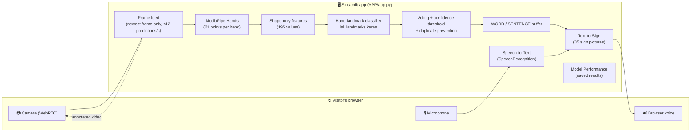
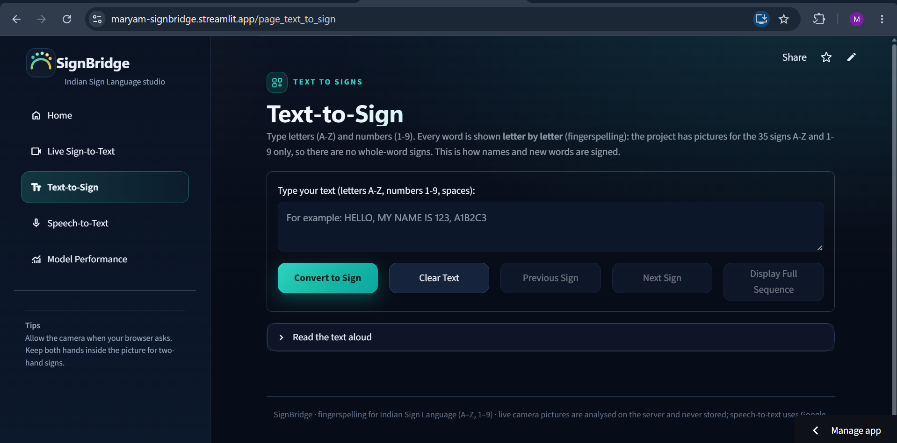
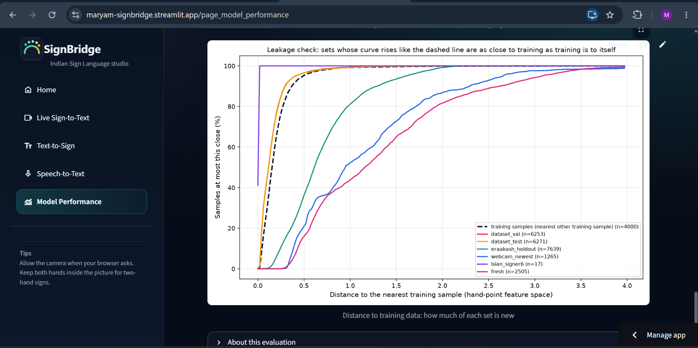

<div align="center">

# 🤟 SignBridge – Indian Sign Language Communication System

**Real-time Indian Sign Language (ISL) fingerspelling: sign → text, text → sign, speech → text.**


🌐 **Live app:** https://maryam-signbridge.streamlit.app *(hosted on Streamlit Community Cloud; live camera needs browser permission and a network that allows WebRTC)*

</div>

---

## 📑 Table of Contents
1. [Project Overview](#-project-overview)
2. [Problem Statement](#-problem-statement)
3. [Objectives](#-objectives)
4. [Key Features](#-key-features)
5. [System Architecture](#-system-architecture)
6. [Technologies Used](#-technologies-used)
7. [Project Folder Structure](#-project-folder-structure)
8. [Model Information](#-model-information)
9. [Dataset Description](#-dataset-description)
10. [Installation Instructions](#-installation-instructions)
11. [How to Run the Application](#-how-to-run-the-application)
12. [How to Use Each Feature](#-how-to-use-each-feature)
13. [Model Evaluation](#-model-evaluation)
14. [Screenshots](#-screenshots)
15. [Limitations](#-limitations)
16. [Future Improvements](#-future-improvements)
17. [Author and Acknowledgements](#-author-and-acknowledgements)

---

## 🌟 Project Overview

**SignBridge** is an AI-based communication system that helps reduce the communication gap between deaf and hearing people. It is built as a single **Streamlit** web application with three tools:

| Tool | What it does |
|---|---|
| 🎥 **Sign-to-Text** | Reads ISL fingerspelling (letters **A–Z** and numbers **1–9**) from a live webcam and builds words and sentences. |
| 🔤 **Text-to-Sign** | Turns typed text into the matching sequence of ISL sign pictures. |
| 🎙️ **Speech-to-Text** | Turns spoken English into text, which can be sent to Text-to-Sign. |

The app also contains a **Model Performance** page that shows the measured results of the evaluation (see [Model Evaluation](#-model-evaluation)).

> ℹ️ SignBridge recognises **fingerspelling of single letters and digits only** (35 classes). It does **not** translate whole ISL words or grammar.

---

## ❗ Problem Statement

Many deaf and hard-of-hearing people use sign language, while most hearing people do not know it. This makes everyday conversation, education and services harder. Interpreters are not always available. A low-cost tool that runs in an ordinary web browser, using only a webcam and a microphone, can help bridge part of this gap.

## 🎯 Objectives

- Recognise ISL alphabets (A–Z) and numbers (1–9) from a webcam in real time.
- Combine recognised characters into words and sentences, with a visible confidence score.
- Show the sign pictures for any typed text, letter by letter.
- Convert speech into text and connect it to the sign display.
- Evaluate the models honestly on data they have not seen, and report what was measured.
- Make the application usable in a browser, including deployment on Streamlit Community Cloud.

---

## ✨ Key Features

### 🎥 Sign-to-Text (live webcam)
- Continuous video from the visitor's browser camera using **streamlit-webrtc**.
- **MediaPipe Hands** finds the hand(s); the hand outline and the predicted character are shown on the live video.
- A **hand-landmark classifier** predicts one of 35 classes (A–Z, 1–9); the **confidence** of each prediction is displayed (confidence is how sure the model is, *not* how often it is right).
- **Add Letter**, **Space**, **Delete Last**, **Clear Word** and **Clear Sentence** build a *WORD* and a *SENTENCE*.
- Optional **Auto-add** (hold a sign for about 1 second), adjustable **confidence threshold** (default 75 %), and Letters / Numbers / All-signs modes.
- **Duplicate prevention:** a letter is chosen by voting over recent frames, and the same letter is not added again until the hand has left the picture (or after a minimum gap).
- Spelling suggestions for the word being built (names are never forced to change).
- Each visitor has an independent session; at most **3 people** can stream the camera at the same time on the free server.

### 🔤 Text-to-Sign
- Type letters, numbers, words and sentences; every word is shown **letter by letter** (the project has pictures for the 35 signs only).
- **Spaces** between words are shown as a `SPACE` step.
- Step through signs with *Previous / Next*, show the **full sequence**, or play an **animated GIF** (up to 60 signs).
- Accented letters are cleaned (for example `é → E`); unsupported symbols produce a warning instead of an error.

### 🎙️ Speech-to-Text
- Records your voice in the browser and converts it to text with the **SpeechRecognition** library (Google Web Speech service, English `en-US`). **This needs internet** and sends the recording to Google.
- The text can be sent to Text-to-Sign.
- **Read aloud** uses the visitor's own browser voice (Web Speech API), so the voice depends on the device.

### 📊 Model Performance
- A read-only page that displays the saved evaluation results and charts. It never calculates or estimates numbers.

---

## 🏗️ System Architecture



**Flow of the live Sign-to-Text path:** the browser sends video frames over WebRTC → only the newest frame is analysed (older frames are dropped so the video never lags) → MediaPipe finds the hand points → the points are turned into a position- and size-independent feature vector → the classifier outputs a probability for each of the 35 classes → a voting window and a confidence threshold decide when a letter is stable → the user adds it to the text.

---

## 🧰 Technologies Used

| Area | Technology |
|---|---|
| Language | Python 3.12 |
| Deep learning | TensorFlow / Keras 2.19, **MobileNetV2** (image model), dense network on hand points (live model) |
| Hand detection | MediaPipe Hands 0.10.21 |
| Image processing | OpenCV 4.11 (contrib build, as required by MediaPipe), NumPy 1.26, Pillow |
| Web app | Streamlit 1.60 |
| Live camera | streamlit-webrtc 0.79.1 (aiortc, PyAV) |
| Speech | SpeechRecognition 3.17 (Google Web Speech service), browser Web Speech API for reading aloud |
| Spelling help | pyspellchecker |
| Deployment | Streamlit Community Cloud (Python 3.12) |

---

## 📁 Project Folder Structure

```text
signbridge-isl/
├── APP/
│   ├── app.py                       # Streamlit entry point (navigation + theme)
│   ├── core/
│   │   ├── webrtc_session.py        # live camera session over WebRTC (per visitor)
│   │   ├── live_session.py          # prediction/commit/text logic shared by the live session
│   │   ├── words.py                 # spelling suggestions and readable sentences
│   │   ├── signs.py                 # Text-to-Sign helpers (pictures, GIF)
│   │   ├── speech_ui.py             # Read aloud (browser voice; Windows voice on a Windows PC)
│   │   ├── tts.py                   # Windows text-to-speech (used only on Windows)
│   │   ├── performance.py           # read-only loader of the saved evaluation results
│   │   └── handoff.py               # send text from one page to another
│   ├── ui/                          # stylesheet and HTML building blocks
│   └── views/                       # the five pages: Home, Live Sign-to-Text,
│                                    #   Text-to-Sign, Speech-to-Text, Model Performance
├── MODELS/
│   ├── isl_landmarks.keras          # hand-landmark classifier (used for live recognition)
│   ├── isl_mobilenetv2.keras        # MobileNetV2 image classifier
│   └── class_names.json             # the 35 class labels
├── SCRIPTS/
│   ├── webcam_speech.py             # model loading, hand detection, prediction helpers
│   └── motion_features.py           # hand-point feature construction
├── SIGN_TO_TEXT/sign_to_text.py     # recogniser, letter committer and text buffer
├── SPEECH_TO_TEXT/speech_to_text.py # speech recognition helper
├── TEXT_TO_SIGN/
│   ├── text_to_sign.py              # text → sign sequence logic
│   └── alphabet_images/             # 35 sign pictures (1–9, A–Z) + mapping.json
├── MODEL_EVALUATION/landmarks/      # saved evaluation results and charts (results.json, *.png)
├── .streamlit/config.toml           # theme
├── requirements.txt                 # Python dependencies
├── packages.txt                     # system libraries for Streamlit Cloud (Linux)
├── test_pages.py                    # automated checks that every page opens
├── test_pipeline.py                 # developer test of the live pipeline (needs recordings not in this repository)
└── DEPLOY_GUIDE.md                  # deployment notes
```

> The training datasets, the training scripts and the author's own recordings are **not** included in this repository (size and privacy).

---

## 🧠 Model Information

SignBridge contains **two** trained models. It is important to know which one does what.

### 1️⃣ Hand-landmark classifier — `MODELS/isl_landmarks.keras` (used for live recognition)
| Property | Value |
|---|---|
| Input | 195 shape-only features computed from MediaPipe hand points (up to two hands) |
| Layers | BatchNormalization → Dense → Dropout → Dense → Dropout → Dense (softmax) |
| Output | 35 classes (A–Z, 1–9) |
| Parameters | 88,367 |
| Why | Using hand **points** instead of pixels makes the model less dependent on background, lighting and skin tone, and it is very fast (one prediction takes about 60–75 ms including hand detection on the development PC). |

The live application (the Streamlit **Live Sign-to-Text** page, and the original OpenCV script) uses this model whenever a hand is found.

### 2️⃣ MobileNetV2 image classifier — `MODELS/isl_mobilenetv2.keras`
| Property | Value |
|---|---|
| Architecture | **MobileNetV2** (ImageNet pre-trained backbone) + Dropout (0.2) + Dense softmax layer |
| Input | 224 × 224 RGB image |
| Output | 35 classes (A–Z, 1–9) |
| Training approach | Transfer learning: the classification head is trained first with the backbone frozen (3 epochs), then fine-tuned (2 epochs); data augmentation is applied |
| Role | **MobileNetV2 is the image-based recogniser of the project.** In the Streamlit app it is loaded together with the hand-landmark model and is used only as a **fallback** when the hand-landmark model file is missing. |

**What MobileNetV2 is:** a small convolutional neural network built from *depthwise-separable convolutions* and inverted residual blocks, designed to be accurate while using little memory and computation, which makes it suitable for real-time and mobile use. Transfer learning reuses what it learned on ImageNet and only adapts it to sign images.

> ⚠️ **Honest note:** the evaluation below shows that the MobileNetV2 model shipped here performs poorly on new recordings (it matched its own test split almost perfectly, but that split contains near-duplicate pictures of the training set). The hand-landmark model generalises better and is therefore the one used for live recognition.

### Live-prediction logic (applied on top of the model)
Confidence threshold (default 75 %), a vote over recent frames, a minimum gap between added letters, and look-alike handling for the identical hand shapes **1/I** and **2/V**.

---

## 🗂️ Dataset Description

Data was **not** published with this repository. The models were trained on a combination of the following sources:

| Source | Description | Licence / reference |
|---|---|---|
| Main ISL image dataset | 42,745 photos of 35 classes (A–Z, 1–9), split 70 / 15 / 15 into training, validation and test | *Source to be added by the author (not documented inside the project)* |
| ISLAN | Photos from several signers; only signs verified to match the project's signs were used | Mendeley Data, DOI [10.17632/rc349j45m5.1](https://doi.org/10.17632/rc349j45m5.1) |
| Indian Sign Language Hand Landmarks Dataset | Pre-computed MediaPipe hand points for 26 signs (50,859 rows) | Kaggle, *eraakash*, CC BY-SA 4.0 |
| Author's own webcam recordings | Hand points recorded with a guided recorder (157 recordings, 5,725 frames used for training) | Recorded by the author |

> ⚠️ **Known data issue (measured):** the original train/validation/test split of the main image dataset was made by randomly splitting frames, so 96.8 % of its test pictures have a near-identical copy in the training set. Its test accuracy therefore says almost nothing about real use. This is why a separate, fresh test set was recorded (see below).

---

## 🛠️ Installation Instructions

**Requirements:** Python **3.12** (TensorFlow 2.19 does not support newer versions), `pip`, a webcam and a microphone for the live features.

```bash
# 1. Clone the repository
git clone https://github.com/maryammehboob-ai/signbridge-isl.git
cd signbridge-isl

# 2. Create and activate a virtual environment
python -m venv .venv
# Windows (PowerShell):
.venv\Scripts\Activate.ps1
# Windows (cmd):        .venv\Scripts\activate.bat
# macOS / Linux:        source .venv/bin/activate

# 3. Install the dependencies
python -m pip install --upgrade pip
pip install -r requirements.txt
```

On **Linux** (including Streamlit Cloud) the system libraries in `packages.txt` are needed for OpenCV:
```bash
sudo apt-get install -y libgl1 libglib2.0-0
```

> The repository is private at the time of writing; you need access to clone it.

---

## ▶️ How to Run the Application

From the repository root:

```bash
python -m streamlit run APP/app.py
```

Open **http://localhost:8501** in your browser. The first visit to *Live Sign-to-Text* takes 10–60 seconds while the models load.

### ☁️ Deploy on Streamlit Community Cloud
1. Push the repository to GitHub (a private repository works if you grant Streamlit access to private repositories).
2. On [share.streamlit.io](https://share.streamlit.io) choose the repository, branch `main`, **Main file path `APP/app.py`**.
3. Under *Advanced settings* select **Python 3.12**, choose your app URL, and deploy.
4. *(Optional)* If live video does not connect on some networks, add a TURN relay in the app's **Secrets** (see `.streamlit/secrets.toml.example`; never commit real credentials).

More details are in [`DEPLOY_GUIDE.md`](DEPLOY_GUIDE.md).

### ✅ Check that every page opens
```bash
python test_pages.py
```

---

## 📖 How to Use Each Feature

### 🎥 Live Sign-to-Text
1. Open **Live Sign-to-Text** and press **START camera**.
2. **Allow the camera** when your browser asks (the camera only works on secure `https` pages or `localhost`).
3. Show a sign to the camera. Keep **both hands fully in the picture** for two-hand signs, with good light.
4. Check **CURRENT PREDICTION** and its **confidence**.
5. Press **Add Letter** to add it to the **WORD**; press **Space** to move the word into the **SENTENCE**.
6. Use **Delete Last**, **Clear Word** or **Clear Sentence** to correct mistakes. Use **Download text** to save the text on your own device, or **Send to Text-to-Sign**.

### 🔤 Text-to-Sign
1. Open **Text-to-Sign** and type text (letters A–Z, numbers 1–9, spaces).
2. Press **Convert to Sign**, then use **Previous / Next Sign**, **Display Full Sequence**, or open **Play as an animated GIF**.
3. Open **Read the text aloud** to hear the text (browser voice).

### 🎙️ Speech-to-Text
1. Open **Speech-to-Text**, click the microphone, speak English, and click again to stop (allow the microphone when asked).
2. The text appears (an internet connection is needed; the recording is sent to Google's speech service).
3. Press **Open in Text-to-Sign** to see the signs for what you said.

### 📊 Model Performance
Open **Model Performance** to see the saved evaluation results and charts.

---

## 📈 Model Evaluation

All numbers below were **measured** by the evaluation scripts of this project (`sklearn.metrics`) and are stored in `MODEL_EVALUATION/landmarks/results.json`. Nothing is estimated.

### ✅ Final result — fresh independent test (hand-landmark model, the live model)
A new set recorded **after** the model was trained, saved outside every training folder, and never used for training or for choosing a model: **69 recordings, 2,505 frames, all 35 signs.**

| Metric | Value |
|---|---|
| **Accuracy (per frame)** | **79.12 %** (95 % interval 71.12 – 86.14 %, computed over recordings) |
| Precision (macro / weighted) | 0.824 / 0.823 |
| Recall (macro / weighted) | 0.794 / 0.791 |
| F1-score (macro / weighted) | 0.787 / 0.785 |
| Top-3 accuracy | 93.01 % |
| Recordings judged right (most frequent answer per recording) | 82.61 % |
| Accuracy counting 1/I and 2/V as the same sign | 83.87 % |
| Frames reaching the app's 0.95 confidence level | 71.66 % of frames; **88.69 %** of those are correct |

Weakest signs (F1 0.35 – 0.44): **2, H, K, S, V**. Most frequent confusions: H→M, 2→V, K→I, V→2, 1→I, S→6, D→L. When the model is wrong it is often still confident (47 % of its mistakes had at least 90 % confidence), so **confidence must not be read as accuracy**.

### 🔁 Same fresh recordings, MobileNetV2 (the model in `MODELS/isl_mobilenetv2.keras`)
| Model | Test pictures | Accuracy | Macro F1 |
|---|---|---|---|
| Hand-landmark model (live) | 2,505 frames | 79.12 % | 0.787 |
| MobileNetV2 (this repository) | 1,246 hand pictures from the same recordings | 9.31 % | 0.067 |

Earlier independent tests of the same MobileNetV2 model gave 14.81 % (95 % interval 9.5 – 20.6 %) on the author's webcam pictures and 8.00 % on other signers' pictures, while its own random test split gave 100 % (leaked, see [Dataset Description](#-dataset-description)).

### ⚠️ Existing-data numbers are **not** final results
| Set | Accuracy | Why it must not be quoted as the model's accuracy |
|---|---|---|
| Training data | 99.59 % | Data the model learned from |
| Original test split (landmark model) | 99.87 % | Random frame split → near-duplicates of training data |
| Author's newest recordings | 92.65 % | These recordings chose which saved model to keep (optimistic) |

### 🔬 How reliable is the 79.12 %?
- It is **independent of the training data and of model selection**, but it was recorded by **one person with the same camera** as the training recordings, so it is **not independent of the signer or camera**. Accuracy for new people, rooms and cameras may be lower.
- To evaluate for new conditions, record again with a different person and camera using `MODEL_EVALUATION` scripts of the full project (not included here) and re-run the evaluation.

---

## 🖼️ Screenshots

> 📌 *Add your screenshots to a `docs/screenshots/` folder and update the paths below.*

| Home | Live Sign-to-Text |
|---|---|
|  |  |

| Text-to-Sign | Speech-to-Text |
|---|---|
|  |  |

| Model Performance |
|---|
|  |

---

## 🚧 Limitations

- **Fingerspelling only:** 35 signs (A–Z, 1–9). No whole-word or sentence-level ISL translation, and no grammar or facial expression.
- **Measured accuracy:** about **79 %** per frame on a fresh test by one signer. Some signs are weak (2, H, K, S, V), and **1/I** and **2/V** have identical hand shapes.
- **MobileNetV2 generalises poorly** on new recordings (see above); the live app depends on the hand-landmark model.
- **Live camera depends on the browser and the network:** it needs camera permission, a secure (https) page and a network that allows WebRTC. Some networks (mobile data, school or office Wi-Fi) may need a TURN relay. It has been tested locally in a real browser with a simulated camera; behaviour on every device and network is **not guaranteed**.
- **Free-hosting limits:** limited CPU and memory; at most 3 simultaneous live-camera users; the app sleeps when idle and the first visit afterwards is slow.
- **Speech-to-Text needs internet** and sends the recording to Google's speech service; English (`en-US`) only.
- **Reading aloud** uses the browser's voice, so quality differs by device.
- **J and Z** are signed with motion; this version predicts single frames.
- Training data and recordings are from a limited set of signers.

---

## 🔮 Future Improvements

- Record and evaluate on **more signers, rooms and cameras**, and retrain with the improved data.
- Add **motion-based recognition** for J and Z.
- Improve the weakest signs (2, H, K, S, V) and resolve the 1/I and 2/V ambiguity using context.
- Extend from fingerspelling to **ISL words and short phrases**.
- Add more speech languages, and support **Indian-English** accents explicitly.
- Provide a TURN-relay configuration by default for more reliable live video.
- Add an offline/desktop package and a mobile-friendly layout for small screens.

---

## 👩‍💻 Author and Acknowledgements

**Author:** Maryam — GitHub: [@maryammehboob-ai](https://github.com/maryammehboob-ai)

*(Add your college, department and project guide here.)*

**Acknowledgements**
- **ISLAN** dataset — Mendeley Data, DOI [10.17632/rc349j45m5.1](https://doi.org/10.17632/rc349j45m5.1).
- **Indian Sign Language Hand Landmarks Dataset** by *eraakash* on Kaggle (CC BY-SA 4.0).
- [MediaPipe](https://developers.google.com/mediapipe), [TensorFlow / Keras](https://www.tensorflow.org/), [OpenCV](https://opencv.org/), [Streamlit](https://streamlit.io/), [streamlit-webrtc](https://github.com/whitphx/streamlit-webrtc) and [SpeechRecognition](https://github.com/Uberi/speech_recognition).
- The MobileNetV2 architecture: Sandler et al., *MobileNetV2: Inverted Residuals and Linear Bottlenecks*, CVPR 2018.

*(Add the source of the main ISL image dataset and a licence for this project before publishing.)*
